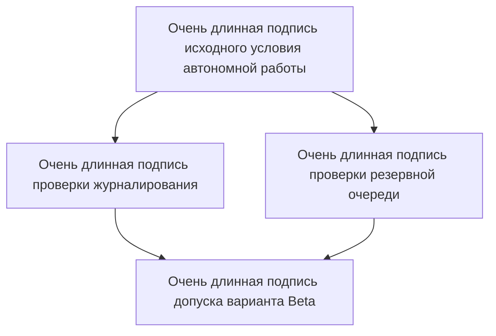

## Содержание

- [[#Вывод|Вывод]]
- [[#Сравнение вариантов|Сравнение вариантов]]
- [[#Условия применения|Условия применения]]
- [[#Схема условий|Схема условий]]

## Вывод

Alpha быстрее в основной выборке, но не допускается при автономной работе. Beta медленнее. Его можно применять только при одновременно включённых журналировании и резервной очереди.

Вывод предварительный и относится только к выборке из 40 запусков. [Описание ограничения](https://example.com/limit) находится рядом с этой оговоркой.

## Сравнение вариантов

| Вариант | Время ответа | Стоимость |
| --- | ---: | ---: |
| Alpha | 12 мс | 4 единицы |
| Beta | 18 мс | 3 единицы |

Alpha требует постоянного подключения. При потере связи операция не завершается, поэтому вариант нельзя рекомендовать для автономного режима.

Beta поддерживает резервную очередь. Без очереди повторная отправка теряется.

## Условия применения

Для Beta обязательны оба условия:

- включено журналирование
- включена резервная очередь

> «Сохраняй условие A; затем проверяй условие B».

```javascript
const ready = logged && queued;
run();
```

## Схема условий


