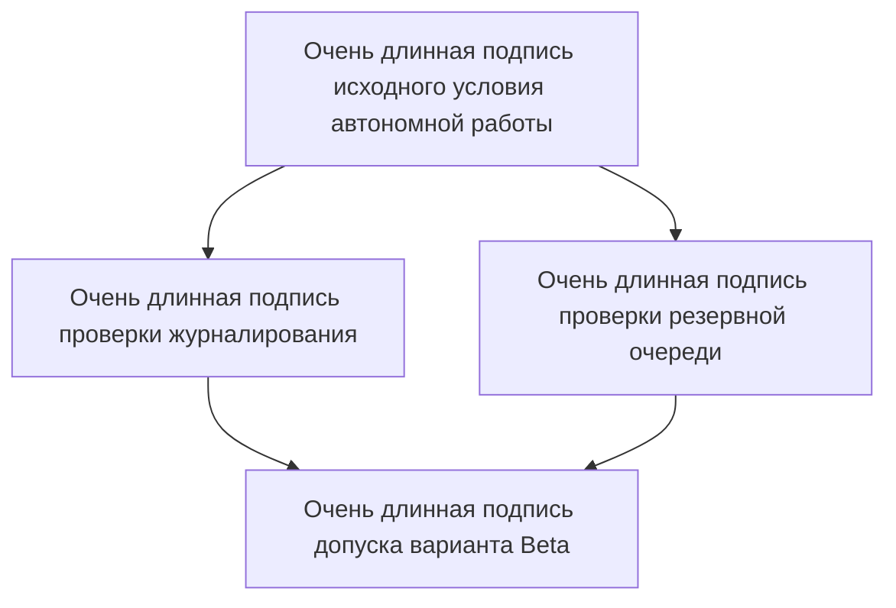

# Синтетический эксперимент

## Содержание

- [[#Сводка эксперимента|Сводка]]
- [[#Старое сравнение|Сравнение]]

## Сводка эксперимента

Вариант Alpha отвечает за 12 мс и стоит 4 единицы, вариант Beta отвечает за 18 мс и стоит 3 единицы, Alpha не допускается при автономной работе, а Beta можно применять только если одновременно включены журналирование и резервная очередь, потому что без очереди повторная отправка теряется, однако этот вывод остаётся предварительным и относится только к выборке из 40 запусков [Описание ограничения](https://example.com/limit).

<table>
<tr><th>Вариант</th><th>Объяснение</th></tr>
<tr><td>Alpha</td><td>Быстрее в основной выборке. Он требует постоянного подключения. При потере связи операция не завершается, поэтому вариант нельзя рекомендовать для автономного режима.</td></tr>
<tr><td>Beta</td><td>Медленнее, но поддерживает резервную очередь. Преимущество появляется только при включённом журналировании и очереди. Оба условия обязательны.</td></tr>
</table>

> «Сохраняй условие A; затем проверяй условие B».

```javascript
const ready = logged && queued;
run();
```


